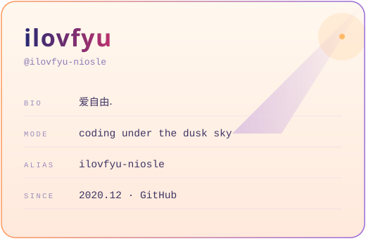
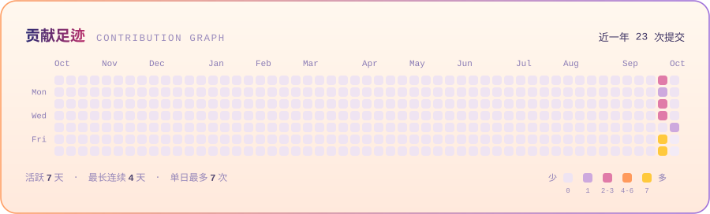
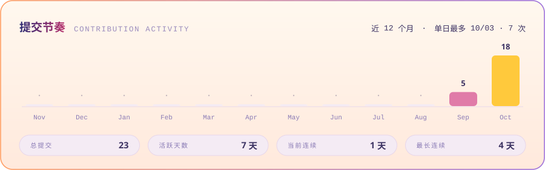
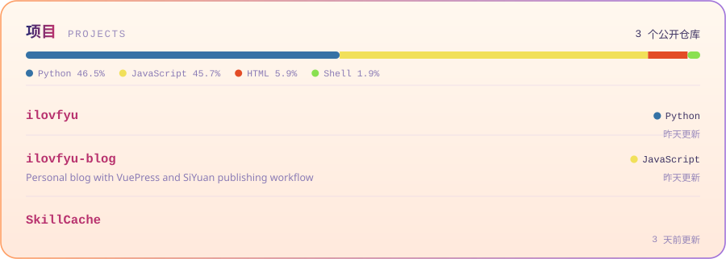

<!-- ═══════════════════════════════════════════════════════════════════════
     ilovfyu · GitHub Profile README
     主题 / Theme：你的名字 · 黄昏 (kataware-doki)

     设计原则：
     · 所有图形都是本仓库自带的 SVG，访客侧不依赖任何第三方服务
     · 「提交数」等统计只有一套口径（tools/build_heatmap.py），避免同一页出现互相矛盾的数字
     · 亮/暗两套主题通过 <picture> + prefers-color-scheme 自动切换

     常用命令：
       python3 tools/build_assets.py     # 改配色后重绘横幅/卡片/分隔/页脚（离线）
       python3 tools/build_heatmap.py    # 拉贡献数据重绘热力图与节奏卡
       python3 tools/build_projects.py   # 拉仓库信息重绘项目卡（含语言构成）
       open preview.html                 # 本地预览整页

     需要你填的地方都标了 ✏️ TODO
     ═══════════════════════════════════════════════════════════════════════ -->

<picture>
  <source media="(prefers-color-scheme: dark)" srcset="assets/banner-dark.svg">
  
</picture>

<!-- ✏️ TODO 有其他主页的话，取消注释并改成你的地址

-->

## 关于我 · About Me

<picture>
  <source media="(prefers-color-scheme: dark)" srcset="assets/card-dark.svg">
  
</picture>

黄昏是一天里光线最好的时候 —— 天空同时有蓝、紫、橙三种颜色，什么都看得清，又什么都不刺眼。
我大概想写出那样的代码。

*Twilight is when the sky holds blue, violet and orange at once — clear, but never harsh.
That's roughly the kind of code I want to write.*

- **在做 / Building** — 打磨 [SkillForge](https://github.com/ilovfyu/SkillForge)
- **喜欢 / Likes** — 干净的界面、克制的代码、长曝光照片
- **在学 / Learning** — 把复杂问题讲简单的能力
- **信条 / Motto** — 把线连起来；代码也是一种「結び」

<!-- ✏️ TODO 上面两段和四条 bullet 换成你自己的，越具体越好 -->

<!-- ✏️ TODO 删掉不用的、加上你真正在用的。写法：
     https://img.shields.io/badge/<名称>-<色号>?style=flat-square&logo=<图标名>&logoColor=white&labelColor=1a1035
     图标名去 https://simpleicons.org 找 -->

<picture>
  <source media="(prefers-color-scheme: dark)" srcset="assets/divider-dark.svg">
  
</picture>

## 数据 · Stats

<picture>
  <source media="(prefers-color-scheme: dark)" srcset="assets/heatmap-dark.svg">
  
</picture>

<picture>
  <source media="(prefers-color-scheme: dark)" srcset="assets/activity-dark.svg">
  
</picture>

<!-- 上面两张卡由 tools/build_heatmap.py 生成，Action 每天自动刷新。
     数据源 github-contributions-api.jogruber.de，只统计「公开」贡献 ——
     所以数字比 GitHub 页面上那个略小（那个含私有贡献）。 -->

<picture>
  <source media="(prefers-color-scheme: dark)" srcset="assets/divider-dark.svg">
  
</picture>

## 项目 · Projects

<picture>
  <source media="(prefers-color-scheme: dark)" srcset="assets/projects-dark.svg">
  
</picture>

<!-- 这张卡由 tools/build_projects.py 生成，Action 每天自动刷新。
     简介、语言、star、更新时间都读自各仓库的 About 字段 ——
     在 GitHub 上把仓库简介补上，下次刷新就会自动出现在这里。
     ✏️ TODO 目前两个仓库的 About 都是空的，补上之后这张卡会好看很多。 -->

<picture>
  <source media="(prefers-color-scheme: dark)" srcset="assets/divider-dark.svg">
  
</picture>

> 「結び」—— 把线连起来。把人和人连起来，把今天和明天连起来。
> 写代码也是一种結び：把脑子里的想法，和真实世界里能跑起来的东西连起来。
>
> *Musubi — tying things together. Code is one way of tying an idea to something that actually runs.*

<picture>
  <source media="(prefers-color-scheme: dark)" srcset="assets/footer-dark.svg">
  
</picture>

用 Markdown、SVG 和黄昏时分的天空手搓 · Hand-built with Markdown, SVG, and a dusk sky

